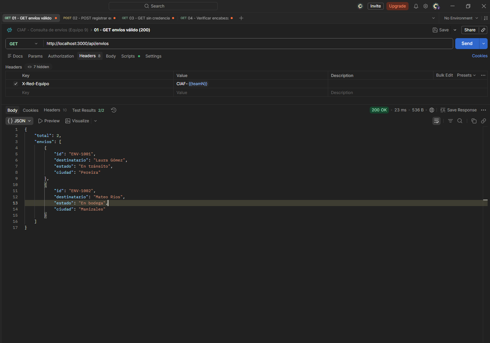
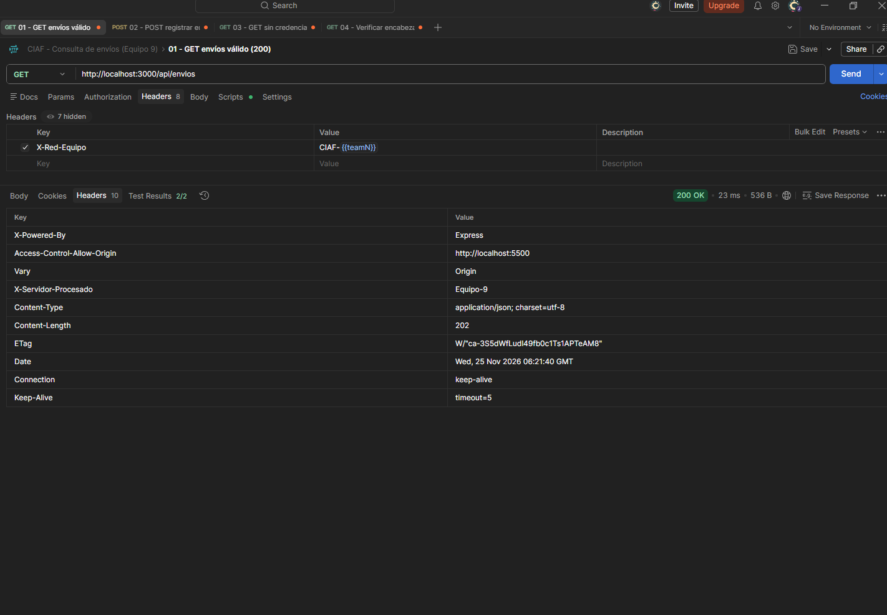
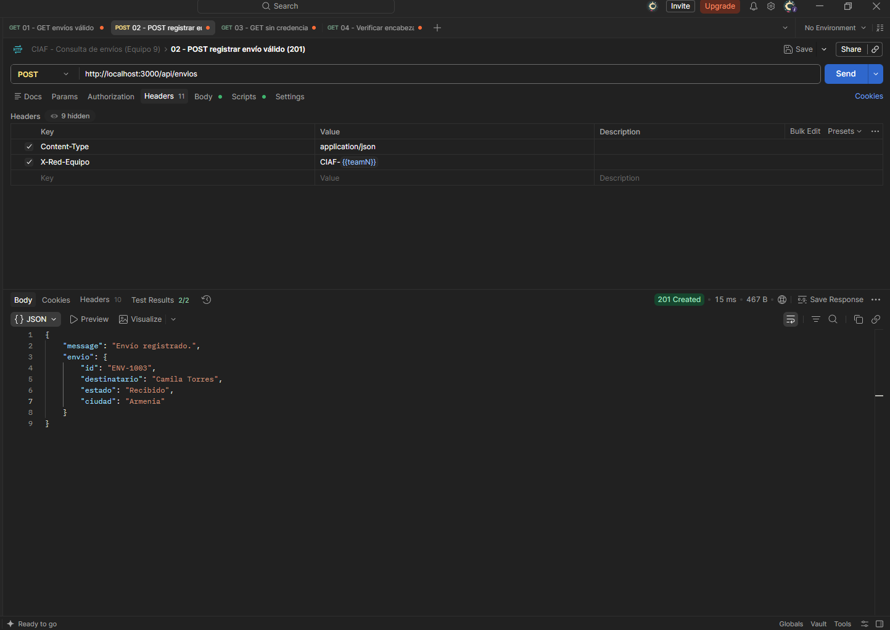
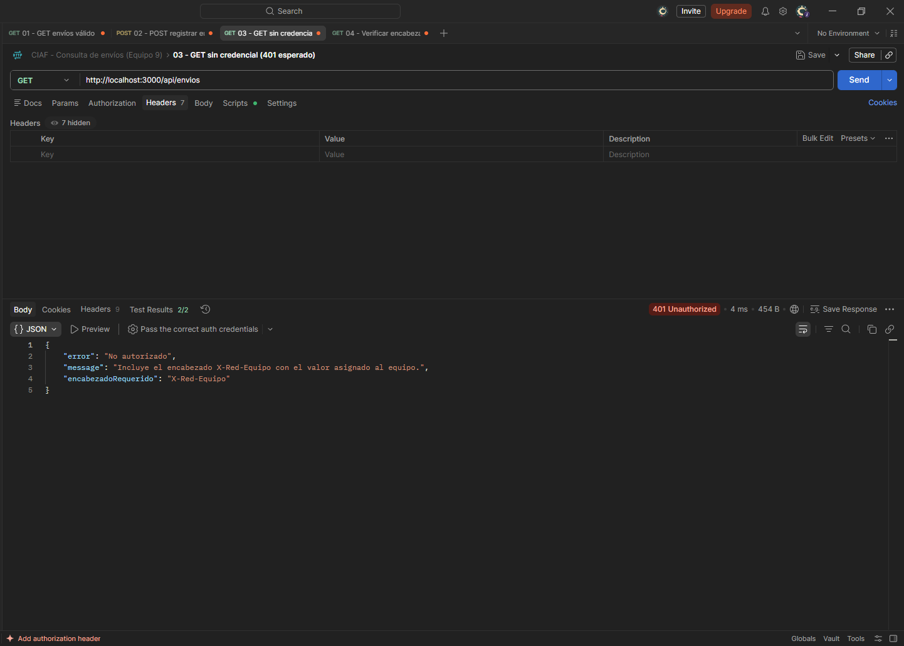
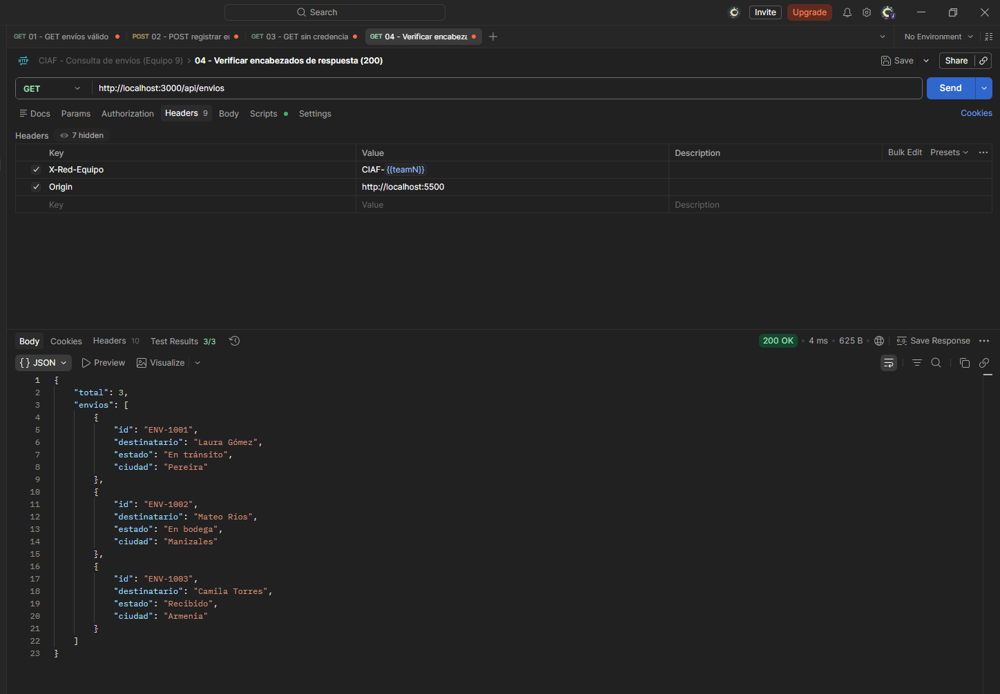
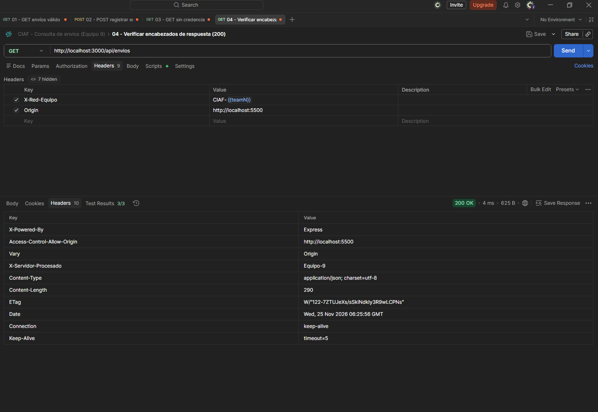

# Taller final - Programación de redes

## Equipo y valor parametrizado

| Orden alfabético por apellidos | Integrante | Número oficial de lista |
|---|---|---:|
| 1 | Juan Esteban García Mendoza | 9 |
| 2 | Luis Hernando Redondo Henao | 19 |
| 3 | Johan Steven Rodríguez Rivera | 22 |

El primer integrante en orden alfabético es García Mendoza, cuyo número de lista es 9. Por tanto, **N = 9**, el valor exacto de `X-Red-Equipo` es `CIAF-9` y el encabezado de respuesta es `X-Servidor-Procesado: Equipo-9`.

## Escenario

El servicio permite consultar y registrar envíos de una empresa de mensajería. Un navegador web alojado en `http://localhost:5500` puede consultar el servicio local en `http://localhost:3000`. También se puede usar Postman para practicar las peticiones.

Si la comunicación viajara por HTTP en una red no confiable, una persona con acceso al tráfico podría leer los datos y la credencial `X-Red-Equipo`, o modificarlos durante el envío. HTTPS usa TLS para cifrar el tráfico entre cliente y servidor, comprobar que el servidor presenta un certificado válido y detectar modificaciones en tránsito. En un despliegue real el servicio debe publicarse detrás de HTTPS; este ejemplo local usa HTTP para facilitar la práctica.

## Requisitos

- Node.js 18 o superior y npm.
- Postman para importar y ejecutar `postman/coleccion-taller-redes.json`.

## Instalación y ejecución

En una terminal, desde la carpeta raíz de este proyecto:

```powershell
npm install
$env:TEAM_N = '9'
$env:ALLOWED_ORIGIN = 'http://localhost:5500'
$env:PORT = '3000'
npm start
```

Deja esa terminal abierta mientras practicas. El servidor mostrará la URL, el origen CORS y la credencial que configuró. No compartas ni cambies `TEAM_N` al importar la colección: el taller asigna el valor 9 a este equipo.

## Endpoints

| Método y ruta | Resultado esperado | Uso |
|---|---:|---|
| `GET /api/envios` | 200 | Consulta los envíos de ejemplo. |
| `POST /api/envios` | 201 | Registra un envío en memoria. El JSON debe tener `destinatario` y `ciudad`. |

Todas las peticiones a `/api` deben llevar `X-Red-Equipo: CIAF-9`. Si falta o no coincide, el middleware responde `401` con un JSON explicativo. Las respuestas exitosas llevan `X-Servidor-Procesado: Equipo-9`. El registro vive en memoria: al reiniciar el servidor, los datos agregados vuelven al estado inicial.

## Colección de Postman

1. Inicia el servidor con los pasos anteriores.
2. En Postman, importa `postman/coleccion-taller-redes.json`.
3. Abre la colección y confirma que sus variables sean `baseUrl = http://localhost:3000` y `teamN = 9`.
4. Ejecuta las peticiones una por una. Las peticiones 01 y 02 son válidas; la 03 omite la credencial y debe recibir 401; la 04 permite observar los encabezados CORS y de procesamiento.
5. En una respuesta exitosa, abre **Headers** y captura el estado y los encabezados `Access-Control-Allow-Origin` y `X-Servidor-Procesado`. En la petición 03, captura el estado 401 y el cuerpo JSON.
6. Guarda las capturas en `screenshots/` y agrégalas al repositorio antes de entregar. La carpeta se incluye para ese propósito; no contiene capturas ficticias.

Postman no aplica las restricciones CORS de los navegadores; la petición 04 envía `Origin` explícitamente para que puedas inspeccionar la respuesta del servidor. CORS controla si un navegador permite a una página de otro origen leer una respuesta. No autentica usuarios ni reemplaza HTTPS. La credencial personalizada es el requisito de acceso de este ejercicio.

## Recorrido de la petición por TCP/IP

1. **Aplicación:** Postman construye una petición HTTP con método, ruta, encabezados (`X-Red-Equipo`, y `Content-Type` para el POST) y, en el POST, el cuerpo JSON. Express recibe la petición, ejecuta CORS y el middleware de credencial, y devuelve estado, encabezados y JSON.
2. **Transporte:** TCP establece una conexión fiable entre cliente y servidor. En esta práctica el servidor escucha en el puerto 3000.
3. **Internet:** IP dirige los paquetes entre las direcciones del cliente y del servidor. Como ambos corren en la misma máquina, se usa la dirección de loopback `127.0.0.1` (localhost).
4. **Acceso a red:** la interfaz de red local transporta las tramas; cuando el tráfico permanece en la misma máquina, el sistema operativo lo encamina internamente por loopback.

En una comunicación HTTPS real, TLS cifra y protege la integridad del flujo HTTP antes de que viaje sobre TCP. CORS es una política aplicada por navegadores: el servidor indica qué origen puede leer la respuesta mediante `Access-Control-Allow-Origin`. Aquí el único origen permitido es `http://localhost:5500`.

## Guion breve para la sustentación

- Mostrar el servidor activo y explicar que Express atiende las rutas, mientras `cors` permite el origen configurado.
- En Postman, mostrar los encabezados enviados en una petición válida, el estado 200 o 201 y los encabezados de respuesta.
- Ejecutar la petición sin `X-Red-Equipo` y explicar por qué el servidor la rechaza con 401.
- Explicar el recorrido TCP/IP y diferenciar CORS (lectura de respuestas por páginas en navegador) de HTTPS/TLS (confidencialidad e integridad durante el transporte).

## Estructura

```text
src/server.js
postman/coleccion-taller-redes.json
screenshots/               # Añade aquí las capturas reales de Postman
package.json
.gitignore
README.md
```

Antes de publicar el repositorio, revisa los nombres y números de lista con el listado oficial y agrega las capturas solicitadas por el docente.

## Capturas de Postman

### 1. GET - Envíos válidos (200)



### 2. GET - Encabezados de respuesta



### 3. POST - Registrar envío válido (201)



### 4. GET - Sin credencial (401)



### 5. Verificar respuesta exitosa (200)



### 6. Verificar encabezados de respuesta (200)


